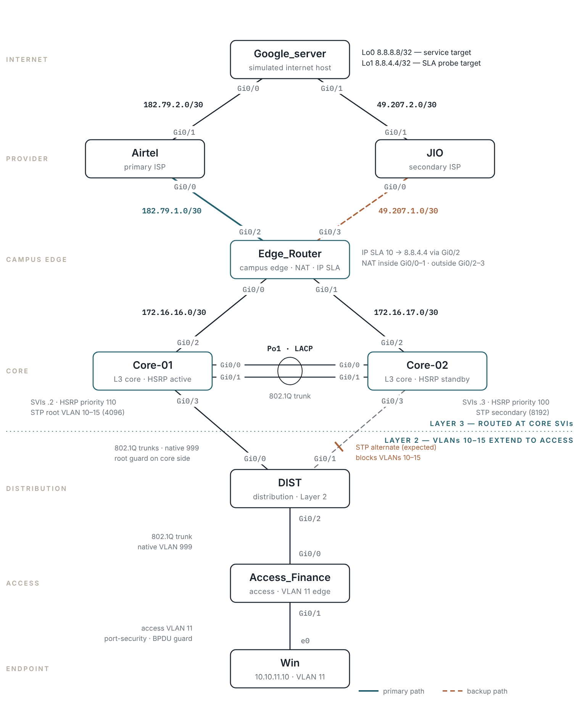

# 🌐 Cisco Three-Tier Campus — Layer 2 Boundary with Dual-ISP Failover

### IP SLA | Object Tracking | Floating Static | Route-Map PAT | HSRP | Rapid-PVST | LACP | STP Guards

### Cisco IOS Campus — Core, Distribution & Access with Two Internet Providers


**Author:** Anurag Mishra |  Solution Architect - IT & Security  
📍 Hyderabad, India | [LinkedIn](https://www.linkedin.com/in/anuragmishra6) | [GitHub](https://github.com/anuragmlocaladdress)

📄 **Full 19-page walkthrough (PDF):** [Cisco_Three-Tier_Campus_L2_Boundary_Lab.pdf](Cisco_Three-Tier_Campus_L2_Boundary_Lab.pdf)

---

## 🗺️ Lab Topology



---

## 📋 Table of Contents

1. [Lab Overview](#1--lab-overview)
2. [Port Matrix & IP Addressing](#2--port-matrix--ip-addressing)
3. [Key Concepts](#3--key-concepts)
4. [Phase 1 — Edge Interfaces & NAT Direction](#4-%EF%B8%8F-phase-1--edge-interfaces--nat-direction)
5. [Phase 2 — IP SLA Probe & Object Tracking](#5-%EF%B8%8F-phase-2--ip-sla-probe--object-tracking)
6. [Phase 3 — Tracked Default & Floating Backup](#6-%EF%B8%8F-phase-3--tracked-default--floating-backup)
7. [Phase 4 — Dual-ISP PAT with Route-Maps](#7-%EF%B8%8F-phase-4--dual-isp-pat-with-route-maps)
8. [Phase 5 — Return-Path Routing to the Campus](#8-%EF%B8%8F-phase-5--return-path-routing-to-the-campus)
9. [Phase 6 — Core: EtherChannel, STP Root & HSRP](#9-%EF%B8%8F-phase-6--core-etherchannel-stp-root--hsrp)
10. [Phase 7 — Distribution & Access Layer](#10-%EF%B8%8F-phase-7--distribution--access-layer)
11. [Phase 8 — Verification Commands](#11--phase-8--verification-commands)
12. [How It All Works Together](#12--how-it-all-works-together)
13. [Failure Scenarios](#13--failure-scenarios)
14. [Lessons Learned & Common Issues](#14-%EF%B8%8F-lessons-learned--common-issues)
15. [Full Device Configurations](#15--full-device-configurations)
16. [References](#-references)

---

## 1. 🧠 Lab Overview

This runbook builds a **three-tier Cisco campus that keeps users online when the main internet provider fails**. Six VLANs stretch from the access switch up to the core (the Layer 2 boundary). Two core switches share the default gateway with HSRP. One edge router connects to two ISPs, watches the primary with IP SLA, and moves traffic to the backup in about 15–20 seconds. Built and tested in EVE-NG.

| Feature                  | Technology Used                                                 |
|--------------------------|-----------------------------------------------------------------|
| ISP Failure Detection    | IP SLA ICMP probe to a far-end target + object tracking         |
| Primary / Backup Routing | Tracked default route (AD 1) + floating static default (AD 10)  |
| Internet for LAN         | NAT Overload / PAT using route-maps — one rule per ISP          |
| Return Path to Campus    | Per-VLAN static routes, floating backup via the second core     |
| Gateway Redundancy       | HSRP v1, MD5 authentication, uplink tracking, preempt           |
| Core Interconnect        | LACP EtherChannel (Po1) 802.1Q trunk                            |
| Loop Prevention          | Rapid-PVST, root placement aligned with HSRP active             |
| Edge Protection          | Root guard, loop guard, BPDU guard, PortFast, port security     |

---

## 2. 📡 Port Matrix & IP Addressing

### Routed Point-to-Point Links

| # | Device A    | Port  | IP Address  | Device B      | Port  | IP Address  | Subnet          |
|---|-------------|-------|-------------|---------------|-------|-------------|-----------------|
| 1 | Edge_Router | Gi0/2 | 182.79.1.2  | Airtel        | Gi0/0 | 182.79.1.1  | 182.79.1.0 /30  |
| 2 | Edge_Router | Gi0/3 | 49.207.1.2  | JIO           | Gi0/0 | 49.207.1.1  | 49.207.1.0 /30  |
| 3 | Airtel      | Gi0/1 | 182.79.2.1  | Google_server | Gi0/0 | 182.79.2.2  | 182.79.2.0 /30  |
| 4 | JIO         | Gi0/1 | 49.207.2.1  | Google_server | Gi0/1 | 49.207.2.2  | 49.207.2.0 /30  |
| 5 | Edge_Router | Gi0/0 | 172.16.16.1 | Core-01       | Gi0/2 | 172.16.16.2 | 172.16.16.0 /30 |
| 6 | Edge_Router | Gi0/1 | 172.16.17.1 | Core-02       | Gi0/2 | 172.16.17.2 | 172.16.17.0 /30 |

### Switched Links

| #  | Device A       | Port  | Device B       | Port  | Mode       | Notes                                              |
|----|----------------|-------|----------------|-------|------------|----------------------------------------------------|
| 7  | Core-01        | Gi0/0 | Core-02        | Gi0/0 | Trunk, Po1 | LACP active both sides                             |
| 8  | Core-01        | Gi0/1 | Core-02        | Gi0/1 | Trunk, Po1 | LACP active both sides                             |
| 9  | Core-01        | Gi0/3 | DIST           | Gi0/0 | Trunk      | Native 999 · root guard on core · DIST root port   |
| 10 | Core-02        | Gi0/3 | DIST           | Gi0/1 | Trunk      | Native 999 · root guard on core · DIST alternate   |
| 11 | DIST           | Gi0/2 | Access_Finance | Gi0/0 | Trunk      | Native 999                                         |
| 12 | Access_Finance | Gi0/1 | Win            | e0    | Access     | VLAN 11 · port security · PortFast · BPDU guard    |

### VLAN Plan

| VLAN | Name              | Subnet          | Gateway (HSRP VIP) | Core-01 | Core-02 |
|------|-------------------|-----------------|--------------------|---------|---------|
| 10   | Device Management | 10.10.10.0 /24  | 10.10.10.1         | .2      | .3      |
| 11   | Data              | 10.10.11.0 /24  | 10.10.11.1         | .2      | .3      |
| 12   | Voice             | 10.10.12.0 /24  | 10.10.12.1         | .2      | .3      |
| 13   | Guest             | 10.10.13.0 /24  | 10.10.13.1         | .2      | .3      |
| 14   | BYOD              | 10.10.14.0 /24  | 10.10.14.1         | .2      | .3      |
| 15   | Quarantine        | 10.10.15.0 /24  | 10.10.15.1         | .2      | .3      |
| 999  | Native (trunks)   | —               | —                  | —       | —       |

### Loopbacks & Hosts

| Device / Interface     | Role                  | IP Address        |
|------------------------|-----------------------|-------------------|
| Google_server — Lo0    | Service target        | 8.8.8.8 /32       |
| Google_server — Lo1    | IP SLA probe target   | 8.8.4.4 /32       |
| DIST — Vlan10          | Switch management     | 10.10.10.10 /24   |
| Access_Finance — Vlan10| Switch management     | 10.10.10.15 /24   |
| Win — e0               | User endpoint, VLAN 11| 10.10.11.10 /24   |

---

## 3. 💡 Key Concepts

**Why IP SLA and not just the interface?**

If the Airtel cable goes down, the static route disappears by itself. But if Airtel's own link to the internet breaks, the edge interface stays **up** and the router keeps sending traffic into a dead path. IP SLA pings a target *beyond* the ISP (`8.8.4.4`), so it notices failures the interface can't see.

**Object Tracking**

The track object turns IP SLA results into a simple **Up / Down** state. `delay down 10 up 15` stops one lost ping from causing a failover, and makes fail-back slower than failover so a flapping line doesn't bounce traffic back and forth.

**Floating Static Route**

A static route has administrative distance 1 by default. Giving the JIO default route distance **10** keeps it hidden while the Airtel route exists. It "floats" into the routing table only when the tracked Airtel route is removed.

**Route-Map NAT for Two ISPs**

Each ISP only routes replies to *its own* addresses. Two PAT rules, each tied to a route-map with `match interface`, make the router pick the NAT address of whichever ISP the packet is actually leaving through. Routing happens before NAT, so the egress interface is already known.

**Layer 2 Boundary at the Core**

Distribution and access are pure Layer 2. Every VLAN's gateway lives on the core SVIs. STP root (Core-01) is placed on the same switch as the HSRP active gateway, so traffic never takes an extra hop across Po1 in normal operation.

---

## 4. ⚙️ Phase 1 — Edge Interfaces & NAT Direction

> Configure the two core-facing links as **NAT inside** and the two ISP links as **NAT outside**.

```text
Edge_Router(config)#interface GigabitEthernet0/0
Edge_Router(config-if)# description Downlink to Core-01 Gi0/2
Edge_Router(config-if)# ip address 172.16.16.1 255.255.255.252
Edge_Router(config-if)# ip nat inside
Edge_Router(config-if)# no shutdown
Edge_Router(config-if)# exit

Edge_Router(config)#interface GigabitEthernet0/1
Edge_Router(config-if)# description Downlink to Core-02 Gi0/2
Edge_Router(config-if)# ip address 172.16.17.1 255.255.255.252
Edge_Router(config-if)# ip nat inside
Edge_Router(config-if)# no shutdown
Edge_Router(config-if)# exit

Edge_Router(config)#interface GigabitEthernet0/2
Edge_Router(config-if)# description UPLINK_TO_AIRTEL_PRIMARY
Edge_Router(config-if)# ip address 182.79.1.2 255.255.255.252
Edge_Router(config-if)# ip nat outside
Edge_Router(config-if)# no shutdown
Edge_Router(config-if)# exit

Edge_Router(config)#interface GigabitEthernet0/3
Edge_Router(config-if)# description UPLINK_TO_JIO_SECONDARY
Edge_Router(config-if)# ip address 49.207.1.2 255.255.255.252
Edge_Router(config-if)# ip nat outside
Edge_Router(config-if)# no shutdown
Edge_Router(config-if)# exit
```

> ✅ Both cores are NAT inside (either core may forward user traffic) · both ISPs are NAT outside

> ℹ️ `ip virtual-reassembly in` appears on these interfaces automatically once NAT is enabled.

---

## 5. ⚙️ Phase 2 — IP SLA Probe & Object Tracking

> Ping a target beyond Airtel every 5 seconds and turn the result into a track object.

### Step 2.1 — Create and Start the IP SLA Probe

```text
Edge_Router(config)#ip sla 10
Edge_Router(config-ip-sla)# icmp-echo 8.8.4.4 source-interface GigabitEthernet0/2
Edge_Router(config-ip-sla-echo)# frequency 5
Edge_Router(config-ip-sla-echo)# exit
Edge_Router(config)#ip sla schedule 10 life forever start-time now
```

| Parameter                   | Why                                                                 |
|-----------------------------|---------------------------------------------------------------------|
| `icmp-echo 8.8.4.4`         | Dedicated probe target two hops away — tests the whole Airtel path  |
| `source-interface Gi0/2`    | Probe uses Airtel address 182.79.1.2, so the reply returns via Airtel |
| `frequency 5`               | One probe every 5 s (timeout left at the IOS default)               |
| `schedule … life forever`   | An SLA does nothing until scheduled — this starts it now, forever   |

### Step 2.2 — Track the Probe

```text
Edge_Router(config)#track 1 ip sla 10 reachability
Edge_Router(config-track)# delay down 10 up 15
Edge_Router(config-track)# exit
```

### Step 2.3 — Pin the Probe to Airtel

```text
! Keeps the probe on Airtel even after the default route moves to JIO
Edge_Router(config)#ip route 8.8.4.4 255.255.255.255 182.79.1.1
```

> ✅ Track 1 is **Up** while Airtel reaches 8.8.4.4, and **Down** after 10 s of failed probes

> ⚠️ This host route is intentionally **not** tracked. Without it, the probe would follow the default route to JIO and the track would report JIO's health as if it were Airtel's.

---

## 6. ⚙️ Phase 3 — Tracked Default & Floating Backup

> Primary default via Airtel tied to track 1. Backup default via JIO with a higher distance.

```text
Edge_Router(config)#ip route 0.0.0.0 0.0.0.0 182.79.1.1 track 1
Edge_Router(config)#ip route 0.0.0.0 0.0.0.0 49.207.1.1 10
```

> ✅ Healthy: default via `182.79.1.1` · After failover: default via `49.207.1.1`

**Failover timing with these values (calculated, not measured):**

| Event    | Time                                                                       |
|----------|----------------------------------------------------------------------------|
| Detect   | Up to 5 s to next probe + up to 5 s timeout + 10 s delay ≈ **15–20 s**     |
| Recover  | Up to 5 s to first good probe + 15 s delay ≈ **15–20 s**                   |

---

## 7. ⚙️ Phase 4 — Dual-ISP PAT with Route-Maps

> One PAT rule per ISP. The route-map picks the rule based on the outgoing interface.

### Step 4.1 — Define Internal Traffic

```text
Edge_Router(config)#ip access-list standard LAN_NETWORKS
Edge_Router(config-std-nacl)# permit 10.10.0.0 0.0.255.255
Edge_Router(config-std-nacl)# exit
```

### Step 4.2 — One Route-Map per ISP

```text
Edge_Router(config)#route-map RM_NAT_AIRTEL permit 10
Edge_Router(config-route-map)# match ip address LAN_NETWORKS
Edge_Router(config-route-map)# match interface GigabitEthernet0/2
Edge_Router(config-route-map)# exit

Edge_Router(config)#route-map RM_NAT_JIO permit 10
Edge_Router(config-route-map)# match ip address LAN_NETWORKS
Edge_Router(config-route-map)# match interface GigabitEthernet0/3
Edge_Router(config-route-map)# exit
```

> ℹ️ Two `match` lines in one sequence are **AND**ed: source must be internal **and** the packet must be leaving that ISP's interface.

### Step 4.3 — Enable PAT for Each ISP

```text
Edge_Router(config)#ip nat inside source route-map RM_NAT_AIRTEL interface GigabitEthernet0/2 overload
Edge_Router(config)#ip nat inside source route-map RM_NAT_JIO interface GigabitEthernet0/3 overload
Edge_Router(config)#ip nat translation timeout 30
```

> ✅ Via Airtel, hosts appear as `182.79.1.2` · Via JIO, hosts appear as `49.207.1.2` — no NAT change needed at failover

> ⚠️ Existing translations don't move to the new ISP. Those sessions reconnect. `clear ip nat translation *` clears them at once but drops **every** active session.

---

## 8. ⚙️ Phase 5 — Return-Path Routing to the Campus

> The edge needs routes back to the six VLANs. Primary via Core-01 (HSRP active), floating backup via Core-02.

### Step 5.1 — Edge Router

```text
Edge_Router(config)#ip route 10.10.10.0 255.255.255.0 172.16.16.2
Edge_Router(config)#ip route 10.10.10.0 255.255.255.0 172.16.17.2 250
Edge_Router(config)#ip route 10.10.11.0 255.255.255.0 172.16.16.2
Edge_Router(config)#ip route 10.10.11.0 255.255.255.0 172.16.17.2 250
Edge_Router(config)#ip route 10.10.12.0 255.255.255.0 172.16.16.2
Edge_Router(config)#ip route 10.10.12.0 255.255.255.0 172.16.17.2 250
Edge_Router(config)#ip route 10.10.13.0 255.255.255.0 172.16.16.2
Edge_Router(config)#ip route 10.10.13.0 255.255.255.0 172.16.17.2 250
Edge_Router(config)#ip route 10.10.14.0 255.255.255.0 172.16.16.2
Edge_Router(config)#ip route 10.10.14.0 255.255.255.0 172.16.17.2 250
Edge_Router(config)#ip route 10.10.15.0 255.255.255.0 172.16.16.2
Edge_Router(config)#ip route 10.10.15.0 255.255.255.0 172.16.17.2 250
```

### Step 5.2 — Core Default Routes

```text
Core-01(config)#ip route 0.0.0.0 0.0.0.0 172.16.16.1
Core-02(config)#ip route 0.0.0.0 0.0.0.0 172.16.17.1
```

> ✅ Outbound and return traffic both use Core-01 — the path stays symmetric

> ⚠️ These floating routes only react to a **link going down**. In production, track each core's /30 with IP SLA or run OSPF between edge and core.

---

## 9. ⚙️ Phase 6 — Core: EtherChannel, STP Root & HSRP

### Step 6.1 — Rapid-PVST and Root Placement

```text
Core-01(config)#spanning-tree mode rapid-pvst
Core-01(config)#spanning-tree loopguard default
Core-01(config)#spanning-tree vlan 10-15 priority 4096

Core-02(config)#spanning-tree mode rapid-pvst
Core-02(config)#spanning-tree loopguard default
Core-02(config)#spanning-tree vlan 10-15 priority 8192
```

> ✅ Core-01 is root for VLANs 10–15 — the same switch that is HSRP active

### Step 6.2 — LACP EtherChannel Between Cores (both cores)

```text
Core-01(config)#interface range GigabitEthernet0/0 - 1
Core-01(config-if-range)# switchport trunk encapsulation dot1q
Core-01(config-if-range)# switchport mode trunk
Core-01(config-if-range)# channel-group 1 mode active
Core-01(config-if-range)# exit

Core-01(config)#interface Port-channel1
Core-01(config-if)# description Inter-Core_Trunk_Link
Core-01(config-if)# switchport trunk encapsulation dot1q
Core-01(config-if)# switchport mode trunk
Core-01(config-if)# exit
```

### Step 6.3 — Routed Uplink to the Edge

```text
Core-01(config)#interface GigabitEthernet0/2
Core-01(config-if)# description Uplink to Router Gi0/0
Core-01(config-if)# no switchport
Core-01(config-if)# ip address 172.16.16.2 255.255.255.252
Core-01(config-if)# exit
```

### Step 6.4 — Downlink Trunk to DIST with Root Guard

```text
Core-01(config)#interface GigabitEthernet0/3
Core-01(config-if)# description Downlink Trunk to DIST Gi0/0
Core-01(config-if)# switchport trunk encapsulation dot1q
Core-01(config-if)# switchport trunk native vlan 999
Core-01(config-if)# switchport mode trunk
Core-01(config-if)# spanning-tree guard root
Core-01(config-if)# exit
```

### Step 6.5 — Track the Uplink

```text
Core-01(config)#track 1 interface GigabitEthernet0/2 line-protocol
```

### Step 6.6 — HSRP per VLAN (VLAN 11 shown — repeat for 10–15)

```text
! Core-01 — active
Core-01(config)#interface Vlan11
Core-01(config-if)# description Data Vlan
Core-01(config-if)# ip address 10.10.11.2 255.255.255.0
Core-01(config-if)# standby 11 ip 10.10.11.1
Core-01(config-if)# standby 11 priority 110
Core-01(config-if)# standby 11 preempt
Core-01(config-if)# standby 11 authentication md5 key-string SecGroup11
Core-01(config-if)# standby 11 track 1 decrement 20
Core-01(config-if)# exit

! Core-02 — standby (priority left at default 100)
Core-02(config)#interface Vlan11
Core-02(config-if)# description Data Vlan
Core-02(config-if)# ip address 10.10.11.3 255.255.255.0
Core-02(config-if)# standby 11 ip 10.10.11.1
Core-02(config-if)# standby 11 preempt
Core-02(config-if)# standby 11 authentication md5 key-string SecGroup11
Core-02(config-if)# standby 11 track 1 decrement 20
Core-02(config-if)# exit
```

| Condition               | Core-01 | Core-02 | Active Gateway            |
|-------------------------|---------|---------|---------------------------|
| Normal                  | 110     | 100     | Core-01                   |
| Core-01 uplink down     | 90      | 100     | Core-02 (preempts)        |
| Core-02 uplink down     | 110     | 80      | Core-01 (no change)       |
| Core-01 uplink restored | 110     | 100     | Core-01 (preempts back)   |

> ✅ Hosts always use `10.10.x.1` — HSRP v1 virtual MAC for group 11 is `0000.0c07.ac0b`

> ⚠️ **Preempt is needed on both cores.** Without it on Core-02, Core-01 would stay active even with a dead uplink.

---

## 10. ⚙️ Phase 7 — Distribution & Access Layer

### Step 7.1 — DIST: Uplinks to Both Cores and Downlink to Access

```text
DIST(config)#spanning-tree mode rapid-pvst
DIST(config)#spanning-tree portfast edge bpduguard default

DIST(config)#interface range GigabitEthernet0/0 - 2
DIST(config-if-range)# switchport trunk encapsulation dot1q
DIST(config-if-range)# switchport trunk native vlan 999
DIST(config-if-range)# switchport mode trunk
DIST(config-if-range)# exit

DIST(config)#interface Vlan10
DIST(config-if)# description Management IP
DIST(config-if)# ip address 10.10.10.10 255.255.255.0
DIST(config-if)# exit
DIST(config)#ip route 0.0.0.0 0.0.0.0 10.10.10.1
```

> ✅ Gi0/0 → Core-01 (root port) · Gi0/1 → Core-02 (expected STP alternate) · Gi0/2 → Access_Finance

### Step 7.2 — Access: Uplink Trunk and Secure User Port

```text
Access_Finance(config)#spanning-tree mode rapid-pvst

Access_Finance(config)#interface GigabitEthernet0/0
Access_Finance(config-if)# description Uplink Trunks to Distribution
Access_Finance(config-if)# switchport trunk encapsulation dot1q
Access_Finance(config-if)# switchport trunk native vlan 999
Access_Finance(config-if)# switchport mode trunk
Access_Finance(config-if)# exit

Access_Finance(config)#interface GigabitEthernet0/1
Access_Finance(config-if)# description Host Endpoint Connection
Access_Finance(config-if)# switchport mode access
Access_Finance(config-if)# switchport access vlan 11
Access_Finance(config-if)# switchport port-security
Access_Finance(config-if)# switchport port-security mac-address sticky
Access_Finance(config-if)# spanning-tree portfast edge
Access_Finance(config-if)# spanning-tree bpduguard enable
Access_Finance(config-if)# exit
```

> ✅ Win (`10.10.11.10`) sits in VLAN 11 · only its MAC is allowed · any BPDU err-disables the port

---

## 11. 🔍 Phase 8 — Verification Commands

> Run these on your own build. Output formats vary between IOS images, so this lists **what to look for**.

### Edge Router — IP SLA & Tracking

```text
Edge_Router#show ip sla configuration 10
Edge_Router#show ip sla statistics 10
Edge_Router#show track 1
```

| Check               | Expected                                       |
|---------------------|------------------------------------------------|
| SLA target / source | 8.8.4.4 · GigabitEthernet0/2 · frequency 5 s   |
| Latest return code  | `OK` · success counter increasing              |
| Track 1 state       | `Up` · delay down 10 / up 15                   |

### Edge Router — Routing & NAT

```text
Edge_Router#show ip route 0.0.0.0
Edge_Router#show ip route static
Edge_Router#show ip nat translations
Edge_Router#show ip nat statistics
Edge_Router#show route-map
```

| Check            | Expected                                                     |
|------------------|--------------------------------------------------------------|
| Default route    | via `182.79.1.1` (via `49.207.1.1` after failover)            |
| LAN routes       | `10.10.x.0/24` via `172.16.16.2`                              |
| NAT translation  | inside local `10.10.11.10` → inside global `182.79.1.2`       |
| NAT statistics   | Gi0/0–0/1 inside · Gi0/2–0/3 outside · hits increasing        |

### Core Switches

```text
Core-01#show standby brief
Core-01#show etherchannel summary
Core-01#show lacp neighbor
Core-01#show spanning-tree root
Core-01#show spanning-tree inconsistentports
```

| Check            | Expected                                                    |
|------------------|-------------------------------------------------------------|
| HSRP             | Core-01 `Active` P 110 · Core-02 `Standby` P 100 (groups 10–15) |
| Po1              | In use · both members bundled                               |
| STP root         | Core-01 for VLANs 10–15                                     |
| Inconsistent     | Empty                                                       |

### Distribution & Access

```text
DIST#show spanning-tree vlan 11
DIST#show interfaces trunk
Access_Finance#show port-security interface GigabitEthernet0/1
```

| Check            | Expected                                         |
|------------------|--------------------------------------------------|
| DIST Gi0/0       | Root · Forwarding                                |
| DIST Gi0/1       | Alternate · Blocking                             |
| Trunks           | Native VLAN 999 · VLANs 10–15 forwarding         |
| Port security    | Secure-up · max 1 · sticky MAC learned           |

### End-to-End from Win

```text
C:\> ping 8.8.8.8 -t
C:\> tracert 8.8.8.8
```

> 🧪 **Failover test:** shut `Gi0/1` on the **Airtel** router (not the edge). That breaks the path beyond the edge — the failure only IP SLA can see. Watch `show track 1` and count the lost pings.

---

## 12. 🔄 How It All Works Together

```
  Win PC (10.10.11.10) — VLAN 11
        |
        | Sends packet to 8.8.8.8
        | Default gateway → 10.10.11.1 (HSRP VIP, answered by Core-01)
        |
  Access_Finance [Gi0/1 access → Gi0/0 trunk, tagged VLAN 11]
        |
  DIST [Gi0/2 in → Gi0/0 root port → Core-01]   (Gi0/1 to Core-02 = STP alternate)
        |
  Core-01 [SVI Vlan11 routes the packet]
        |
        | Default route → 172.16.16.1 (Gi0/2)
        |
  Edge_Router [Gi0/0 — NAT Inside]
        |
        | Track 1 Up → default via 182.79.1.1 → egress Gi0/2
        | RM_NAT_AIRTEL matches → src 10.10.11.10 → 182.79.1.2 (port mapped)
        |
  Edge_Router [Gi0/2 — NAT Outside] → Airtel → Google_server (8.8.8.8)
        |
        | Reply returns to 182.79.1.2 via Airtel
        |
  Edge_Router: NAT un-translate → 10.10.11.10 → route via 172.16.16.2 (Core-01)
        |
  Core-01 → DIST → Access_Finance → Win PC receives reply ✅

  ── Airtel path fails ───────────────────────────────────────────
  IP SLA to 8.8.4.4 times out → after 10 s track 1 Down
  Default via 182.79.1.1 removed → floating default via 49.207.1.1 installs
  New flows exit Gi0/3 → RM_NAT_JIO → src becomes 49.207.1.2 → JIO → 8.8.8.8 ✅
  Inside the campus nothing changes: same gateway, same core, same STP path
```

---

## 13. 💥 Failure Scenarios

| # | Failure                               | Detected By                           | What Changes                                         | Impact                                 |
|---|---------------------------------------|---------------------------------------|------------------------------------------------------|----------------------------------------|
| 1 | Airtel upstream fails                 | IP SLA timeout → track 1 Down (10 s)  | Default moves to JIO · NAT uses RM_NAT_JIO           | ~15–20 s · existing sessions reconnect |
| 2 | Edge Gi0/2 / Airtel handoff down      | Connected route lost                  | Same as above                                        | Similar                                |
| 3 | Airtel restored                       | Probes OK → track Up after 15 s       | Primary default returns                              | New flows back on Airtel               |
| 4 | Edge ↔ Core-01 link down              | Core-01 track 1 · Edge loses /30      | Core-02 HSRP active · return routes float to Core-02 | Seconds                                |
| 5 | Core-01 fails completely              | HSRP hold timer · RSTP                | Core-02 active and STP root                          | Up to ~10 s (HSRP hold)                |
| 6 | DIST Gi0/0 fails                      | RSTP                                  | Gi0/1 becomes root port                              | Brief · path via Core-02 → Po1 → Core-01 |
| 7 | Switch plugged into Win's port        | BPDU guard                            | Port err-disabled                                    | Port down until recovered              |
| 8 | Different device on Win's port        | Port security                         | Violation → port shut down                           | Port down until recovered              |
| 9 | Rogue switch claims STP root          | Root guard on core Gi0/3              | Port root-inconsistent                               | Root stays at Core-01                  |

---

## 14. ⚠️ Lessons Learned & Common Issues

| # | Symptom                                         | Root Cause                                          | Fix                                                                 |
|---|-------------------------------------------------|-----------------------------------------------------|---------------------------------------------------------------------|
| 1 | Track stays Up when Airtel's upstream is down   | Probe target is the ISP next hop, not a far target  | Probe an address **beyond** the ISP (`8.8.4.4`)                      |
| 2 | Track flaps after failover                      | Probe follows the default route to the backup ISP   | Pin the probe: `ip route 8.8.4.4 255.255.255.255 182.79.1.1`        |
| 3 | Backup works but replies never come back        | Single NAT rule using one ISP's address             | One route-map NAT rule per ISP with `match interface`               |
| 4 | Failover never happens                          | `ip sla schedule` missing                           | `ip sla schedule 10 life forever start-time now`                    |
| 5 | Core-01 uplink down but Core-02 doesn't take over | `preempt` missing on Core-02                      | Add `standby <grp> preempt` on **both** cores                       |
| 6 | Traffic crosses Po1 for no reason               | STP root and HSRP active on different cores         | Put STP root and HSRP active on the same switch                     |
| 7 | HSRP shows both cores Active                    | MD5 key mismatch or VLAN not on the Po1 trunk       | Match `key-string` per group · check `show interfaces trunk`        |
| 8 | Trunk not carrying VLANs                        | Native VLAN mismatch or VLANs not created            | Native 999 on both ends · create VLANs 10–15 on every switch        |
| 9 | User port err-disabled                          | BPDU guard or port-security violation               | Remove the cause, then `shutdown` / `no shutdown`                   |

---

## 15. 📂 Full Device Configurations

| Device         | Role                              | File                                                  |
|----------------|-----------------------------------|-------------------------------------------------------|
| Edge_Router    | Campus edge · NAT · IP SLA        | [configs/Edge_Router.txt](configs/Edge_Router.txt)       |
| Core-01        | Core · HSRP active · STP root     | [configs/Core-01.txt](configs/Core-01.txt)               |
| Core-02        | Core · HSRP standby               | [configs/Core-02.txt](configs/Core-02.txt)               |
| DIST           | Distribution · Layer 2            | [configs/DIST.txt](configs/DIST.txt)                     |
| Access_Finance | Access · VLAN 11 edge             | [configs/Access_Finance.txt](configs/Access_Finance.txt) |
| Airtel         | Primary ISP (simulated)           | [configs/Airtel.txt](configs/Airtel.txt)                 |
| JIO            | Secondary ISP (simulated)         | [configs/JIO.txt](configs/JIO.txt)                       |
| Google_server  | Internet host (simulated)         | [configs/Google_server.txt](configs/Google_server.txt)   |

> ℹ️ Platform defaults (duplex, speed, negotiation, boot markers) are left out to keep files short. Three extra Edge static routes (next hops `8.8.8.8` / `4.4.4.4` and a `1.1.1.1` host route) are marked *under review* — they don't change the failover behaviour.

📄 Every line above is explained in detail in the **[PDF walkthrough](Cisco_Three-Tier_Campus_L2_Boundary_Lab.pdf)**.

---

## 📚 References

- [Cisco — Reliable Static Routing Backup Using Object Tracking](https://www.cisco.com/en/US/docs/ios/dial/configuration/guide/dia_rel_stc_rtg_bckup.html)
- [Cisco IOS NAT Configuration Guide](https://www.cisco.com/c/en/us/support/docs/ip/network-address-translation-nat/13772-12.html)
- [Understanding NAT Overload (PAT)](https://www.cisco.com/c/en/us/support/docs/ip/network-address-translation-nat/13706-9.html)

---

**Anurag Mishra** —  Solution Architect - IT & Security 
📍 Hyderabad, India

[](https://www.linkedin.com/in/anuragmishra6)
[](https://github.com/anuragmlocaladdress)

*All configurations are from a lab environment built in EVE-NG. Sanitize IPs and credentials before production use.*
